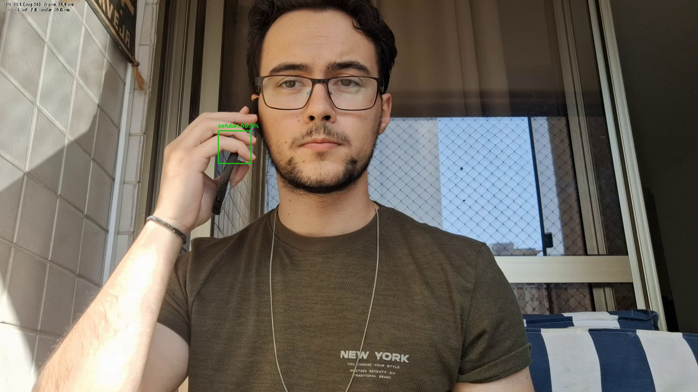
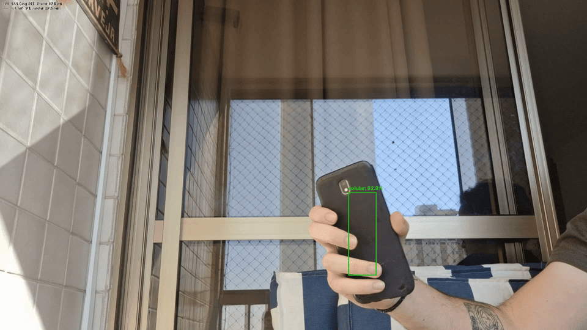
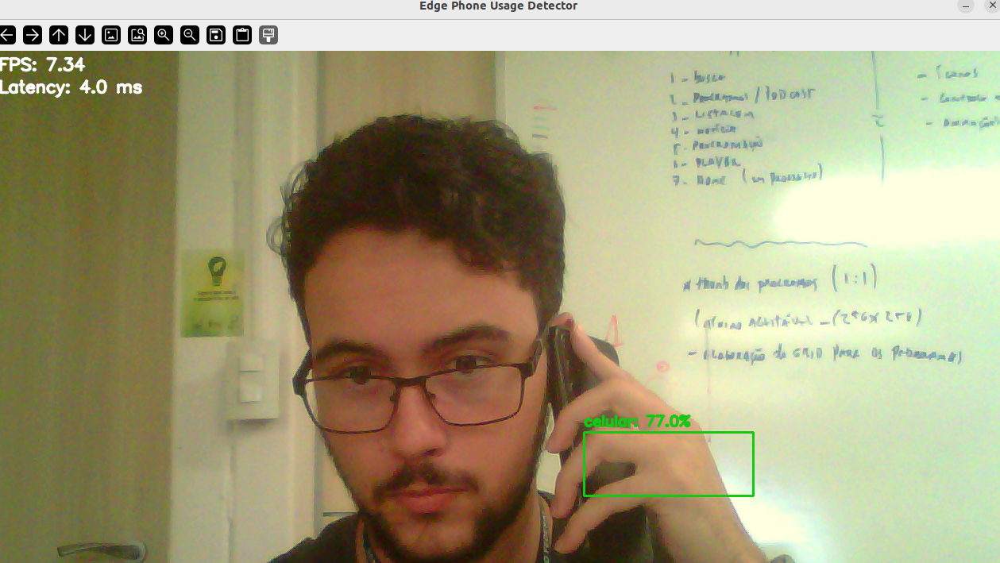
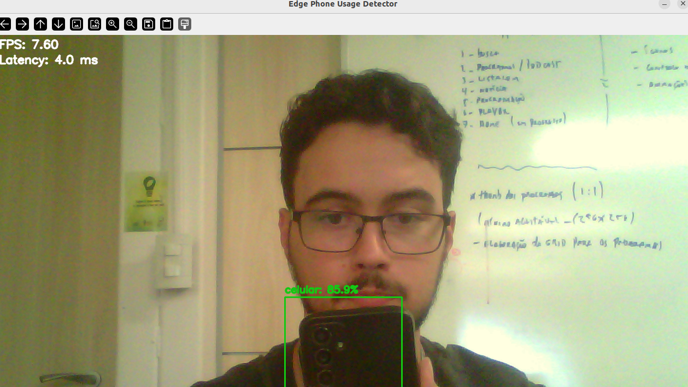

# edge-phone-usage-detector

Aplicação de visão computacional em tempo real para detecção de uso de celular via webcam, com foco em cenários de segurança no trânsito e monitoramento de comportamento do condutor.

O projeto utiliza um modelo treinado no Edge Impulse no formato **`.eim` (Linux x86_64)**.

## 📸 Demo

Exemplos de detecção em tempo real:






## Problema que o projeto resolve

Uso de celular ao volante é um fator recorrente em acidentes e quase-acidentes, principalmente por reduzir tempo de reação e atenção situacional do condutor. Este projeto demonstra uma pipeline de visão computacional em tempo real para detecção desse comportamento, servindo como base técnica para protótipos de monitoramento em cabine, validação de regras de segurança e estudos de assistência ao motorista.

## Tecnologias

- Python 3.10+
- OpenCV (`opencv-python`)
- NumPy
- Edge Impulse Linux Python SDK / runtime compatível com `.eim` (instalação pode variar por ambiente)

## Estrutura do projeto

```text
.
├── assets/examples/          # Mídias para demonstração (prints/gifs)
├── docs/ARCHITECTURE.md      # Arquitetura técnica e fluxo
├── model/                    # Pasta do modelo Edge Impulse .eim
├── scripts/run_dev.sh        # Script de execução local
├── src/
│   ├── main.py               # Entrypoint
│   └── app/
│       ├── config/           # Configurações
│       ├── domain/           # Entidades de domínio
│       ├── services/         # Câmera, inferência e pipeline
│       └── utils/            # Logging e paths
├── tests/                    # Testes básicos
├── requirements.txt          # Dependências Python base (sem runtime Edge Impulse fixo)
└── .gitignore
```

## Instalação

### 1) Criar ambiente virtual

```bash
python3 -m venv .venv
```

### 2) Ativar ambiente virtual

```bash
source .venv/bin/activate
```

### 3) Instalar dependências base

```bash
pip install --upgrade pip
pip install -r requirements.txt
```

### 4) Instalar runtime Edge Impulse compatível com `.eim`

A parte de inferência `.eim` depende de runtime/SDK Edge Impulse disponível no seu Linux. O nome exato do pacote e versão podem variar.

Exemplo comum (quando disponível no seu ambiente):

```bash
pip install edge_impulse_linux
```

Se esse pacote não estiver disponível para sua plataforma, consulte a documentação oficial do Edge Impulse para Linux e instale o runner Python equivalente.

## Modelo `.eim`

Coloque o modelo em:

```bash
model/cellphone_detector.eim
```

Observações:

- Este projeto **não** trata o modelo como TFLite/ONNX/PyTorch.
- A inferência é feita por runtime Edge Impulse compatível com `.eim`.

## Como rodar

### Opção 1: script

```bash
bash scripts/run_dev.sh
```

### Opção 2: comando direto

```bash
python -m src.main \
  --model-path model/cellphone_detector.eim \
  --camera-index 0 \
  --camera-width 640 \
  --camera-height 480 \
  --min-confidence 0.5
```

Controles:

- `q` para encerrar.

> O modelo recebe 96x96. Capturar acima de 640x480 não acrescenta precisão e
> consome banda USB, que é justamente o gargalo do laço — veja
> [Desempenho](#desempenho).

### Opção 3: a partir de um arquivo de vídeo

Útil onde não há webcam exposta — WSL2, por exemplo, não traz V4L2/UVC no
kernel — e para validar a pipeline sobre material gravado externamente.

```bash
python -m src.main --source entrada.mp4 --record anotado.mp4
```

Nesse modo as opções `--camera-*` são ignoradas (com aviso no log), e a
diferença de comportamento em relação à webcam é intencional:

| | Webcam ao vivo | Arquivo |
| --- | --- | --- |
| Quadros atrasados | Descartados (só o mais recente importa) | Nenhum descarte: todos processados em ordem |
| Fim da fonte | Não existe; encerra com `q` | Encerra sozinho, sem erro |
| FPS da gravação | Taxa de processamento medida | Herdado do arquivo de entrada |
| Etapa no profiling | `capture` | `decode` |

O FPS de saída herda o da entrada de propósito: gravar no ritmo de
processamento faria a demonstração sair acelerada ou lenta. Se o container
reportar um FPS inválido, o fallback é 30 e fica registrado no log.

### Gravar vídeo de demonstração

Grava os quadros já anotados direto em mp4, no FPS real medido. Sem screen
recording: não há barra de título, cursor nem borda de janela no resultado.

```bash
python -m src.main --record demo.mp4
```

Para gerar material em modo headless (também útil para medir quanto o `imshow`
está custando):

```bash
python -m src.main --record demo.mp4 --no-display
```

### Medir o desempenho

Processa exatamente N quadros e imprime média, mediana e p95 de cada etapa do
laço, mais o FPS efetivo:

```bash
python -m src.main --profile-frames 200
```

```text
stage              n   mean ms   median ms    p95 ms    share
-------------------------------------------------------------
capture          200     20.20       20.65     23.40    60.5%
preprocess       200      1.49        1.46      2.18     4.5%
inference        200      2.83        2.61      3.73     8.5%
draw             200      0.31        0.27      0.51     0.9%
display          200      5.11        4.89      6.60    15.3%
-------------------------------------------------------------
frame total      200     33.39       33.31     36.61   100.0%
```

### Flags adicionais

| Flag | Efeito |
| --- | --- |
| `--source CAMINHO` | Lê quadros de um arquivo de vídeo em vez da webcam. |
| `--record CAMINHO.mp4` | Grava os quadros anotados. FPS medido para webcam, FPS da entrada para arquivo. |
| `--no-display` | Roda sem janela OpenCV (headless). Exige `--record` ou `--profile-frames`. |
| `--profile-frames N` | Processa N quadros, imprime o relatório de etapas e sai. |
| `--camera-fourcc MJPG` | Formato de captura. Útil quando o driver escolhe YUYV e limita o frame rate. |
| `--fps-window N` | Quadros usados na média móvel de FPS do overlay (padrão 30). |

## Desempenho

O overlay mostra apenas números medidos por este laço:

- FPS por média móvel dos últimos 30 quadros, não instantâneo.
- Tempo total do quadro em ms.
- Decomposição: captura / inferência / render.

A latência que o runner `.eim` reporta (`timing.dsp + timing.classification`)
cobre **só a rede nativa** — medida aqui em ~1 ms. Ela não inclui extração de
features, IPC, desenho nem exibição, e por isso não serve como indicador de
FPS. Foi essa a origem da leitura de "4 ms de inferência" convivendo com 3–8
FPS na tela.

### Antes/depois

Medido com 200 quadros, i5-1335U, runner `.eim` real, câmera emulada com o
mesmo período nos dois lados (10 fps a 1280x720 e 30 fps a 640x480, tetos
típicos de YUYV em USB 2.0):

| Etapa | Antes | Depois | Ganho |
| --- | ---: | ---: | ---: |
| captura | 78.88 ms | 20.20 ms | 3.90x |
| pré-processamento | 9.19 ms | 1.49 ms | 6.19x |
| inferência | 2.99 ms | 2.83 ms | 1.06x |
| desenho | 0.56 ms | 0.31 ms | 1.83x |
| exibição | 8.02 ms | 5.11 ms | 1.57x |
| **total do quadro** | **99.72 ms** | **33.39 ms** | **2.99x** |
| **FPS efetivo** | **10.03** | **29.94** | **2.99x** |

O que cada correção resolveu:

- **Resolução de captura 1280x720 → 640x480.** Origem do maior ganho. A 720p
  em YUYV cada quadro custa 1,84 MB e o barramento USB 2.0 limita a entrega a
  ~10 fps; o `cap.read()` passa o tempo todo bloqueado esperando a câmera.
- **`get_features_from_image_auto_studio_settings` no lugar de
  `get_features_from_image`.** A função antiga do SDK percorre os 9.216 pixels
  em loop Python. A vetorizada usa numpy e aplica o mesmo `fit-shortest` do
  treino. A 640x480 as features saem idênticas byte a byte.
- **Downscale antes da conversão de cor.** O `cvtColor` rodava sobre o quadro
  inteiro para alimentar um modelo 96x96.
- **Thread produtora com slot único + `CAP_PROP_BUFFERSIZE=1`.** Não aumenta
  FPS quando o consumidor já é mais rápido que a câmera: o que compra é
  frescor. Sem isso, a fila do driver entrega quadros capturados vários
  períodos atrás e a latência acumula. O produtor descarta o quadro anterior
  em vez de enfileirar, então o laço sempre processa o mais recente.

## Integração `.eim` no projeto

`EimInferenceService` tenta usar `ImageImpulseRunner` via SDK Python do Edge Impulse para:

1. Inicializar o modelo `.eim` no Linux.
2. Converter frame de BGR para RGB.
3. Executar inferência por frame.
4. Ler `result.bounding_boxes` e normalizar saída para o pipeline.

A aplicação faz tratamento defensivo para falhas de inicialização, ausência de runtime e resposta inesperada do runner.

## Tratamento de erros implementado

- Webcam indisponível.
- Arquivo `.eim` ausente ou inválido.
- Falha ao inicializar runtime Edge Impulse.
- Erro durante inferência.
- Dependências ausentes.

## Limitações técnicas reais

### Desempenho

- **O FPS é limitado pela câmera, não pela inferência.** Depois das correções, a
  captura ainda responde por ~60% do tempo do quadro, e esse tempo é espera
  pelo próximo quadro do driver. Todo o resto do laço custa ~13 ms, ou seja,
  o software sozinho comportaria ~75 FPS. Na prática o teto é o frame rate que
  a webcam negocia.
- **Webcams USB 2.0 em YUYV são o caso ruim.** A 1280x720 o barramento limita a
  entrega a cerca de 10 fps. Se a sua câmera suportar MJPG, `--camera-fourcc
  MJPG` remove esse limite às custas de decodificação; nem todo driver aceita.
- **`imshow` custa ~5 ms por quadro** e é a etapa de software mais cara que
  sobrou. Medido sob WSLg/X11, onde o overhead é maior que em sessão nativa.
  `--no-display` elimina esse custo para gravação e medição.
- Os números de antes/depois em [Desempenho](#desempenho) foram medidos num
  i5-1335U com o runner `.eim` real, mas com **câmera emulada** — não havia
  webcam no ambiente de medição. Os custos de pré-processamento, inferência,
  desenho e exibição são medições reais; a captura usa um período fixo baseado
  nos tetos típicos de USB 2.0. Para o número real do seu hardware, rode
  `python -m src.main --profile-frames 200`.
- `CAP_PROP_BUFFERSIZE` é uma sugestão: vários backends a ignoram
  silenciosamente. A thread produtora com descarte cobre esse caso.
- A gravação buffeiriza os primeiros 30 quadros para descobrir o FPS real antes
  de abrir o `VideoWriter`. Numa cena com frame rate muito instável, o arquivo
  fica com um FPS fixo que representa a média, não a variação.

### Modelo

- O runtime `.eim` depende de suporte da plataforma Linux e bibliotecas nativas.
- O arquivo `.eim` precisa ter permissão de execução (`chmod +x`), porque o SDK
  o executa como subprocesso e conversa por socket. O git não preserva esse bit
  em todos os fluxos de clone.
- Metadados de modelo (`model_info`) podem variar por versão do SDK.
- O modelo atual foi treinado com entrada reduzida (96x96, **1 canal —
  grayscale**), o que limita detalhe espacial e pode degradar a precisão das
  bounding boxes.
- O modo de resize é `fit-shortest`: o modelo enxerga apenas o **quadrado
  central** do quadro. Objetos nas bordas laterais ficam fora do campo de visão
  da detecção, mesmo estando visíveis na imagem exibida.
- A capacidade de generalização ainda é limitada: variações de iluminação, ângulo da câmera, oclusões parciais e contexto de fundo podem alterar significativamente a confiança da detecção.
- A qualidade final depende fortemente do dataset (diversidade de cenários, balanceamento de classes e qualidade de anotação).
- Bounding boxes podem ficar imprecisas em objetos pequenos, movimentos rápidos e enquadramentos fora do padrão de treino.

## ⚠️ Status atual do modelo

O modelo `.eim` atual deve ser considerado um **protótipo experimental**.

- A pipeline de software (captura de webcam, inferência, renderização e tratamento de erros) está funcional.
- As principais limitações observadas estão concentradas na etapa de treinamento do modelo e na cobertura do dataset, e não na arquitetura geral da aplicação.
- Dependendo da posição do celular, postura do condutor e condições da cena, a detecção pode ocorrer com baixa confiança ou gerar classificações incorretas.

## 🧠 Roadmap de melhoria

- Expandir o dataset com maior diversidade de iluminação, câmera, ângulos e perfis de condutor.
- Melhorar a qualidade das anotações para tornar as bounding boxes mais consistentes.
- Incluir mais exemplos negativos (mão no rosto, objetos parecidos, gestos sem celular) para reduzir falsos positivos.
- Avaliar outras arquiteturas de object detection e diferentes configurações de treino/export no Edge Impulse.
- Adotar versionamento de modelos `.eim` com rastreabilidade de métricas por versão (ex.: precisão, recall, FPS).

## Melhorias futuras

- Filtro temporal para reduzir falsos positivos.
- Export de eventos (timestamp + confiança) em CSV/JSON.
- Modo headless (sem UI) para edge devices.
- Testes de integração com mock do runner e testes em hardware real.

## Arquitetura detalhada

Consulte `docs/ARCHITECTURE.md`.

## 🎓 Objetivo do projeto

Este projeto foi construído para demonstrar, de forma prática e profissional:

- Integração entre ML aplicado e engenharia de software.
- Implementação de pipeline de inferência em tempo real com webcam.
- Organização arquitetural modular e manutenção de código em camadas.
- Aplicação de visão computacional em um problema real de segurança no trânsito.
