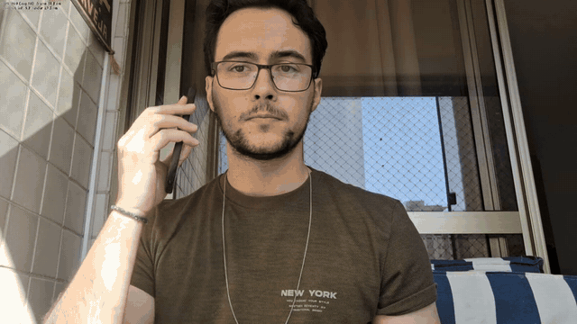

# edge-phone-usage-detector


Detecção de uso de celular em tempo real, com um modelo do Edge Impulse (`.eim`) e OpenCV. Otimizei a pipeline de cerca de 10 para cerca de 30 FPS, medido com `--profile-frames` e câmera emulada.



## Por que fiz

É meu primeiro projeto de visão computacional na borda, feito a partir de um curso que fiz há bastante tempo.

Escolhi detectar uso de celular ao volante para dar um propósito ao projeto. Não é uma pesquisa em segurança no trânsito, e não trato o caso de uso como mais do que isso.

O modelo é o menos importante aqui. Usei o Edge Impulse para chegar rápido a um modelo funcionando. O que o projeto mostra de fato é a engenharia em volta dele (pipeline em camadas, fonte de vídeo, tratamento de erros, testes) e a investigação de desempenho.

## Resultado

| | Antes | Depois |
| --- | ---: | ---: |
| FPS efetivo | 10,03 | 29,94 |
| Tempo do quadro | 99,72 ms | 33,39 ms |

Ganho de 2,99x no total. Esses números foram medidos com **câmera emulada** (o WSL não tem webcam). Detalhes em [Desafios](#desafios-e-o-que-aprendi).


## Como funciona


Cada etapa é cronometrada separadamente pelo `FrameProfiler`. A fonte de vídeo roda numa thread produtora. O pré-processamento reduz o quadro para a entrada do modelo (96x96) antes de converter a cor. A inferência chama o runner `.eim`. O desenho aplica as caixas sobre o quadro original e mostra FPS e tempos no HUD.

O código está em camadas: `config`, `domain`, `services` e `utils`. Os detalhes estão em [docs/ARCHITECTURE.md](docs/ARCHITECTURE.md).

## Decisões técnicas

**1. Captura a 640x480.**
O modelo recebe 96x96, então capturar mais não acrescenta precisão. A 1280x720 em YUYV, cada quadro tem 1,84 MB e o USB 2.0 limita a entrega a cerca de 10 fps. Alternativa: manter 720p e pedir MJPG, que remove o limite de banda, mas troca banda por custo de decodificação e nem todo driver aceita (existe a flag `--camera-fourcc` para testar).

**2. Thread produtora com slot único.**
O `cap.read()` bloqueia até a câmera entregar. Executado dentro do laço, ele faz toda a pipeline andar no ritmo da câmera. Na thread, o produtor guarda só o quadro mais recente e descarta o anterior. Alternativa: uma fila. Em tempo real um quadro velho não tem valor, e a fila só acumularia latência.

**3. `FrameSource` com duas classes, não uma com flags.**
`ThreadedFrameSource` (webcam) descarta quadros atrasados. `VideoFileFrameSource` usa uma fila bloqueante e não descarta nada, porque um quadro perdido de um arquivo é conteúdo perdido. As duas diferem justamente no que fazer com um quadro que o consumidor não alcançou. Alternativa: uma classe com um modo por flag, misturando as duas políticas.

**4. Pré-processamento vetorizado.**
A função `get_features_from_image` do SDK percorre os 9.216 pixels num laço Python. Uso `get_features_from_image_auto_studio_settings`, que é vetorizada com numpy. Reduzo a imagem antes de converter a cor, e o recorte `fit-shortest` é reproduzido para mapear as caixas de volta ao quadro. A 640x480, as features saem idênticas byte a byte às da versão antiga.

**5. Medir cada etapa, em vez de confiar na latência do runner.**
O tempo que o runner `.eim` reporta cobre só a rede nativa. Cronometrar cada etapa do laço foi o que mostrou onde o tempo realmente ia. Alternativa: usar o número do runner como indicador de FPS, que é o que gerava a leitura enganosa descrita abaixo.

## Desafios e o que aprendi

### Desempenho: de ~10 para ~30 FPS

No notebook que eu usava na época, as imagens saíam com qualidade ruim e o FPS era baixo. Isso foi só o contexto que motivou a investigação: não tem medição associada.

O runner reportava cerca de 4 ms de inferência, enquanto a tela mostrava 3 a 8 FPS. Os dois números não fechavam. Esse tempo cobre só a rede nativa (~1 ms medido aqui), sem extração de features, IPC, desenho nem exibição. Em vez de confiar nele, cronometrei cada etapa do laço.

A tabela abaixo foi medida com 200 quadros num i5-1335U, com o runner `.eim` real e câmera emulada:

| Etapa | Antes | Depois | Ganho |
| --- | ---: | ---: | ---: |
| captura | 78,88 ms | 20,20 ms | 3,90x |
| pré-processamento | 9,19 ms | 1,49 ms | 6,19x |
| inferência | 2,99 ms | 2,83 ms | 1,06x |
| desenho | 0,56 ms | 0,31 ms | 1,83x |
| exibição | 8,02 ms | 5,11 ms | 1,57x |
| **total do quadro** | **99,72 ms** | **33,39 ms** | **2,99x** |
| **FPS efetivo** | **10,03** | **29,94** | **2,99x** |

**Ressalva importante:** o WSL não tem webcam, então a captura foi **emulada**, com o mesmo período dos dois lados (10 fps a 1280x720 e 30 fps a 640x480, tetos típicos de YUYV em USB 2.0). Pré-processamento, inferência, desenho e exibição são medições reais. O tempo de captura é um período fixo, não uma medição de webcam. Para o número do seu hardware, rode `python -m src.main --profile-frames 200`.

O que cada correção resolveu:

- **Resolução de captura 1280x720 → 640x480.** Maior ganho. A 720p o `cap.read()` passava o tempo bloqueado esperando a câmera.
- **Pré-processamento vetorizado.** Tirou o laço Python sobre os 9.216 pixels.
- **Downscale antes da conversão de cor.** O `cvtColor` rodava sobre o quadro inteiro para alimentar um modelo 96x96.
- **Thread produtora com slot único e `CAP_PROP_BUFFERSIZE=1`.** Não aumenta o FPS quando o consumidor já é mais rápido que a câmera. O que compra é frescor: sem isso a fila do driver entrega quadros capturados vários períodos atrás.

Depois disso, a captura ainda ocupa cerca de 60% do quadro, e é espera pela câmera. O resto do laço custa cerca de 13 ms. O teto passou a ser o frame rate que a webcam negocia, não o software.

### Viés de pose: o que o teste com vídeo real mostrou

Ao testar com vídeo real, o modelo detectou o celular de forma consistente perto da orelha. Falhou quando o aparelho estava em outras posições, como na altura do peito ou com a tela voltada para a câmera, mesmo com boa iluminação e sem obstrução.

Interpreto como um reflexo do dataset: o modelo parece ter associado "celular" ao contexto da mão perto da cabeça, mais do que às características visuais do objeto. Não tenho acesso aos detalhes do dataset para confirmar. O viés de pose mostra que um modelo pode funcionar bem nos casos de teste e ainda assim ter aprendido a pista errada.

O modelo também é limitado por coisas que não aparecem no código, como a entrada de 96x96 em grayscale e o recorte central. Do lado do desempenho, medir cada etapa evitou otimizar o lugar errado.

## Limitações e próximos passos

**Limitações**

- **É um protótipo experimental.** A pipeline de software está funcional. As limitações vêm do modelo.
- **Viés de pose**, descrito acima.
- **Entrada 96x96 em grayscale** (1 canal): pouco detalhe espacial, o que pode piorar a precisão das caixas.
- **Recorte central** (`fit-shortest`): o modelo enxerga só o quadrado central do quadro. Objetos nas bordas laterais ficam fora da detecção, mesmo visíveis na imagem.
- **Sem métricas formais.** O modelo foi treinado no Edge Impulse e não tenho números de treino para citar.
- **Medição com câmera emulada**, como explicado em Desafios.
- O FPS é limitado pela câmera, não pela inferência.

**Próximos passos**

O próximo projeto vai usar um modelo treinado por mim, sem Edge Impulse, com dataset e métricas próprios.

## Stack

Python 3.10+, OpenCV, NumPy, Edge Impulse Linux SDK (modelo `.eim`), pytest e GitHub Actions.

## Rodar localmente

```bash
python3 -m venv .venv && source .venv/bin/activate
pip install -r requirements.txt && pip install edge_impulse_linux
chmod +x model/cellphone_detector.eim
python -m src.main
```

Para arquivo de vídeo, gravação, profiling e todas as flags, veja [docs/SETUP.md](docs/SETUP.md).
